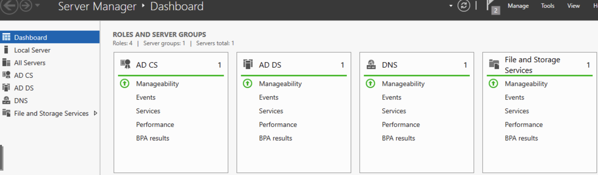
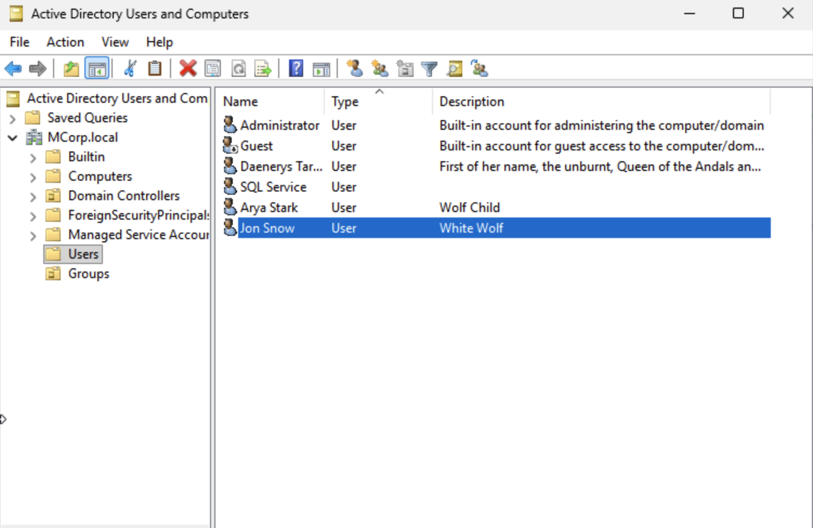
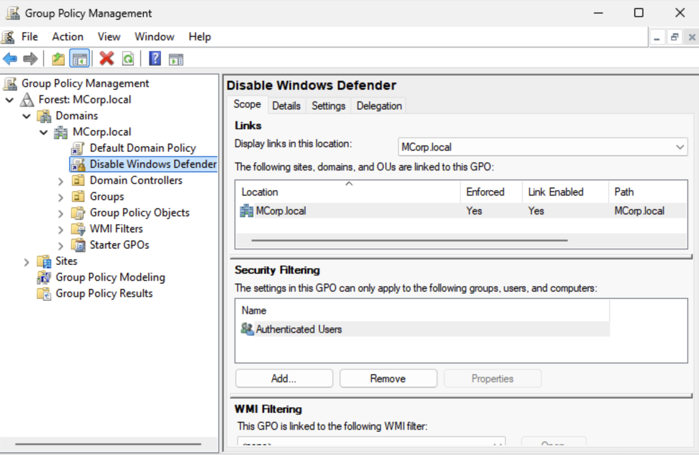

# Active Directory Domain Services

## Purpose

This phase built a centralized Windows identity environment for the cybersecurity lab using Active Directory Domain Services.

DC01 was configured as the domain controller for the `MCorp.local` domain, providing centralized authentication, DNS, user and computer management, and Group Policy capabilities for the Windows environment.

## Scope

This documentation covers the Active Directory configuration process, including:

- Windows Server domain controller configuration
- Active Directory Domain Services deployment
- DNS configuration
- `MCorp.local` domain creation
- Active Directory user and group creation
- Group Policy configuration
- Validation of the domain environment

## Domain Services Configuration

Windows Server was configured as the domain controller for the lab environment.

The server was configured with the following core services:

- Active Directory Domain Services
- DNS
- Active Directory Certificate Services
- File and Storage Services

The domain was created as `MCorp.local`.

DC01 was assigned the IP address `10.0.1.2` and provides domain and DNS services for the Windows systems on the MCORP network.

This configuration established the centralized identity and authentication foundation required for domain-joined endpoints, Group Policy, and future security monitoring activities.

## Users, Groups, and Group Policy

Created Active Directory users and groups to support centralized identity management within the `MCorp.local` domain.

Configured Group Policy to centrally manage Windows system settings across the domain.

Configuration activities included:

- Creating domain user accounts
- Organizing users and computers within Active Directory
- Creating and managing security groups
- Configuring Group Policy
- Linking Group Policy to the domain
- Verifying that domain policies were available for managed Windows systems

This configuration provides a centralized way to manage identities, permissions, and Windows security settings across the lab environment.

## Skills Demonstrated

This phase demonstrates core Windows identity and administration skills, including:

- Active Directory Domain Services deployment
- Windows Server domain controller configuration
- DNS integration with Active Directory
- Domain creation and management
- User and group administration
- Group Policy configuration
- Centralized identity and access management
- Validation of Windows domain services

These skills support the broader cybersecurity lab by providing the identity infrastructure needed for endpoint management, centralized authentication, security monitoring, and future attack simulation.

## Evidence

### Active Directory Server Roles

This screenshot shows the Windows Server roles configured on DC01, including Active Directory Domain Services and DNS.

### Active Directory Users and Groups

This screenshot shows the `MCorp.local` Active Directory environment with configured user and computer objects used in the lab.

### Group Policy Configuration

This screenshot shows Group Policy configuration linked to the `MCorp.local` domain, demonstrating centralized policy management for Windows systems.

---

