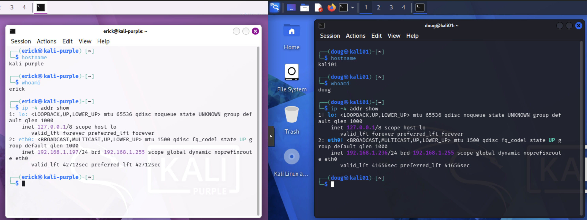

# Linux Security VM Deployment

## Purpose

This phase deployed the Linux-based security systems used for attack simulation and defensive security operations within the lab.

Kali Linux and Kali Purple were deployed as separate systems to support offensive testing, defensive analysis, and future detection and incident-response activities.

## Scope

This documentation covers the deployment and validation of:

- Kali Linux
- Kali Purple
- Initial system configuration
- Hostname and user validation
- Network configuration
- Preparation for attack simulation and defensive security tooling

## Kali Linux and Kali Purple Roles

The Linux security systems were deployed with separate offensive and defensive roles within the lab.

### Kali Linux

Kali Linux was deployed on the ATTACKLAN network and is used as the primary attack simulation and security testing workstation.

Its role includes:

- Reconnaissance
- Network scanning
- Security testing
- Controlled attack simulation
- Future adversary emulation activities

### Kali Purple

Kali Purple was deployed on the ALLSAFE network and is used as the defensive security workstation.

Its role includes:

- Defensive security tooling
- Security monitoring
- Wazuh deployment
- Detection and analysis workflows
- Future threat-hunting activities

Separating the offensive and defensive systems into different network zones supports controlled testing and clearer security monitoring across the lab.

## Linux VM Validation

The Linux security virtual machines were validated after deployment to confirm that each system was operating correctly and connected to the expected lab network.

Validation included:

- Confirming Kali Linux successfully booted
- Confirming Kali Purple successfully booted
- Verifying hostname and logged-in user information
- Confirming IP configuration
- Verifying each system was placed on the intended network
- Confirming the systems were ready for future offensive and defensive security activities

This validation confirmed that both Linux security systems were operational and ready to support attack simulation, monitoring, detection, and analysis workflows.

## Skills Demonstrated

This phase demonstrates Linux virtualization and security lab deployment skills, including:

- Kali Linux deployment
- Kali Purple deployment
- Linux virtual machine configuration
- Hostname and user validation
- IP and network configuration verification
- Separation of offensive and defensive security systems
- Preparation of Linux systems for security testing and monitoring
- Integration of Linux-based tooling into a segmented cybersecurity lab

These skills support the broader cybersecurity lab by providing dedicated systems for attack simulation, defensive monitoring, detection workflows, and future threat-hunting activities.

## Evidence

### Kali Linux and Kali Purple Validation

This screenshot shows system identity and network configuration validation for both Kali Linux and Kali Purple after deployment.

The validation confirms that the Linux security systems were operational and connected to their intended lab environments, supporting their separate offensive and defensive roles.

---
