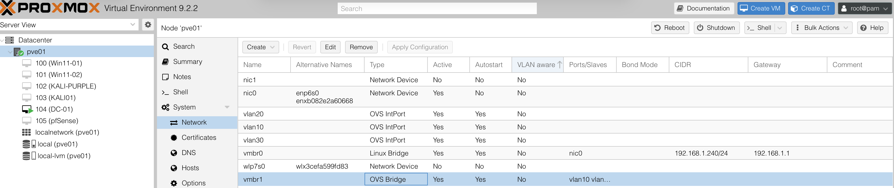
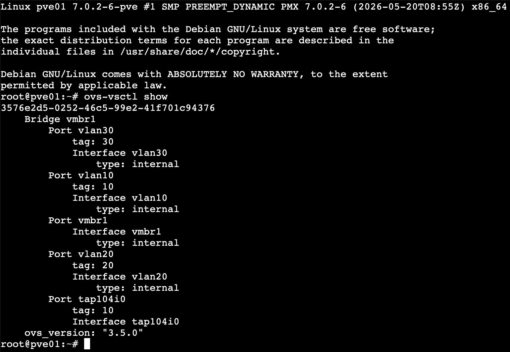

# Open vSwitch Network Configuration

## Purpose

This phase configured Open vSwitch in Proxmox to support the lab’s segmented virtual networking design.

Open vSwitch provides the virtual switching layer that organizes and separates traffic between the enterprise, defensive security, and attack simulation networks.

## Scope

This documentation covers the Open vSwitch configuration process, including:

- Open vSwitch installation and configuration
- Proxmox OVS bridge setup
- Internal network interface configuration
- VLAN-style network segmentation
- Validation of bridge and port assignments

## Open vSwitch Network Layout

Open vSwitch was configured in Proxmox using an OVS bridge and internal ports to support the segmented lab networks.

The configuration includes:

| Component | Configuration | Purpose |
|---|---|---|
| OVS Bridge | vmbr1 | Virtual switching layer for internal lab traffic |
| Internal Port | vlan10 | Supports the MCORP network |
| Internal Port | vlan20 | Supports the ALLSAFE network |
| Internal Port | vlan30 | Supports the ATTACKLAN network |

The internal ports were assigned VLAN tags to separate traffic between the enterprise, defensive security, and attack simulation networks while allowing Proxmox to host the virtualized environment on a shared switching layer.

## Bridge and VLAN Configuration

The Proxmox host was configured with an Open vSwitch bridge named `vmbr1` to support internal lab traffic.

Three OVS internal ports were created and assigned VLAN tags:

- `vlan10` — VLAN 10 for the MCORP network
- `vlan20` — VLAN 20 for the ALLSAFE network
- `vlan30` — VLAN 30 for the ATTACKLAN network

This design logically separates the lab’s enterprise, defensive security, and attack simulation environments while allowing the networks to coexist on the same virtual switching infrastructure.

Open vSwitch was used alongside pfSense, which provides routing and firewall control between the segmented networks.

## Validation

The Open vSwitch configuration was validated from the Proxmox host by reviewing the network configuration and confirming the OVS bridge and internal ports were present.

Validation included:

- Confirming the `vmbr1` OVS bridge was created
- Verifying the `vlan10`, `vlan20`, and `vlan30` internal ports
- Confirming the expected VLAN tag assignments
- Reviewing Open vSwitch configuration from the Proxmox host
- Using `ovs-vsctl show` to confirm the bridge and port relationships

This validation confirmed that the virtual switching layer was configured and ready to support the segmented MCORP, ALLSAFE, and ATTACKLAN networks.

## Skills Demonstrated

This phase demonstrates virtualization and network engineering skills, including:

- Open vSwitch configuration
- Virtual bridge deployment
- VLAN-based network segmentation
- Virtual interface configuration
- Proxmox networking
- Validation using command-line networking tools
- Integration of virtual switching with firewall-based routing and segmentation

These skills support the lab’s broader security architecture by providing the network separation required for enterprise systems, defensive tooling, and attack simulation.

## Evidence

### Proxmox Open vSwitch Network Configuration

This screenshot shows the Open vSwitch configuration in Proxmox, including the `vmbr1` OVS bridge and the internal ports used for the segmented lab networks.

### Open vSwitch Command-Line Validation

This screenshot shows the output of `ovs-vsctl show`, validating the Open vSwitch bridge, internal ports, and VLAN tag assignments for the MCORP, ALLSAFE, and ATTACKLAN networks.

---
---
