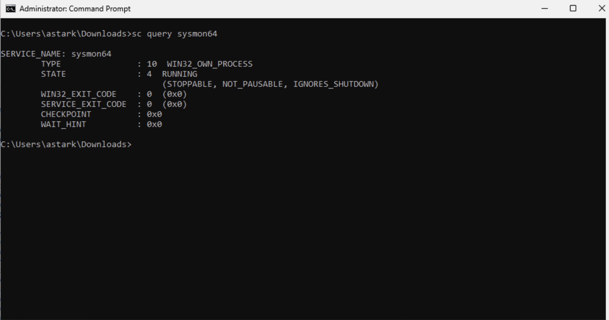
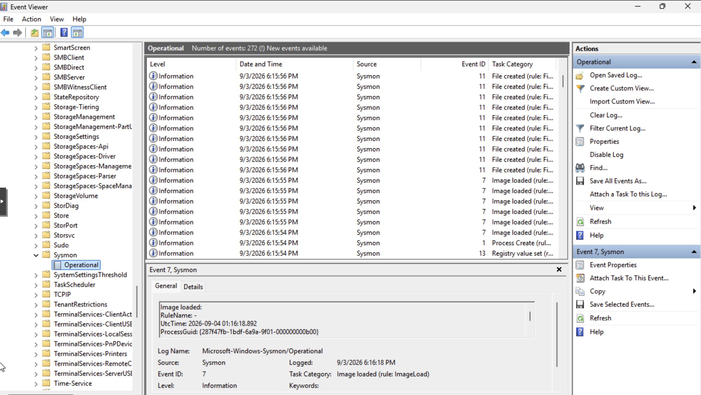

# Sysmon Telemetry

## Purpose

This phase aimed to improve endpoint visibility across the Windows lab environment using Sysmon.

Sysmon was deployed to generate detailed Windows event telemetry that can support security monitoring, detection engineering, threat hunting, and incident-response activities.

## Scope

This documentation covers the Sysmon deployment and validation process, including:

- Sysmon installation on Windows systems
- Sysmon service validation
- Windows Event Viewer log verification
- Review of Sysmon Operational events
- Confirmation of endpoint telemetry generation
- Preparation of Windows systems for SIEM/XDR monitoring

## Sysmon Deployment

Sysmon was installed across the Windows lab environment to provide enhanced endpoint telemetry beyond standard Windows logging.

The deployment included:

- DC01
- Win11-01
- Win11-02

After installation, the Sysmon service was verified to ensure it was running successfully on the Windows systems.

Sysmon logging provides detailed event data to monitor process activity, file creation, registry changes, driver and image loading, and other endpoint behaviors relevant to security analysis.

## Telemetry and Event Log Validation

Validated Sysmon telemetry in Windows Event Viewer using the Sysmon Operational log.

Validation confirmed that Sysmon was actively generating endpoint telemetry across the Windows lab environment.

Observed event activity included examples such as:

- Process creation
- File creation
- Image loading
- Registry activity

Sysmon events were visible under:

`Applications and Services Logs > Microsoft > Windows > Sysmon > Operational`

The presence of Sysmon events confirmed that the Windows systems were successfully generating enhanced endpoint telemetry for future SIEM ingestion, detection engineering, threat hunting, and incident-response analysis.

## Skills Demonstrated

This phase demonstrates endpoint monitoring and telemetry skills, including:

- Sysmon deployment and service validation
- Windows Event Viewer analysis
- Endpoint telemetry verification
- Review of process, file, image, and registry activity
- Windows security logging
- Preparation of endpoint data for SIEM/XDR ingestion
- Foundational detection engineering and threat-hunting readiness

These skills support the broader cybersecurity lab by providing the endpoint visibility needed for monitoring, investigation, detection development, and incident-response activities.

## Evidence

### Sysmon Service Validation

This screenshot shows the Sysmon service running on a Windows system, confirming that the endpoint monitoring service was successfully installed and active.

### Sysmon Operational Logs

This screenshot shows Sysmon events being generated in Windows Event Viewer under the Sysmon Operational log. The visible events confirm that enhanced endpoint telemetry was being collected for future monitoring, detection, threat-hunting, and incident-response activities.

---

