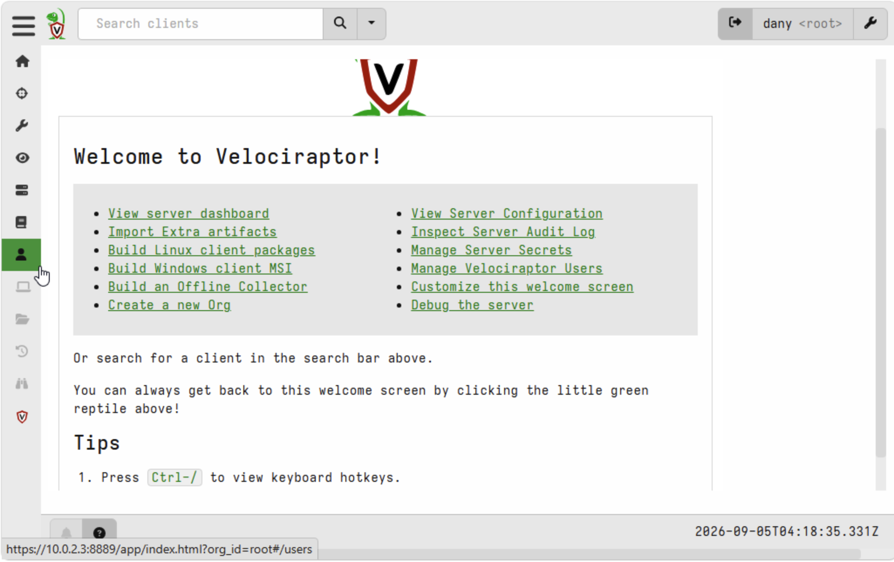
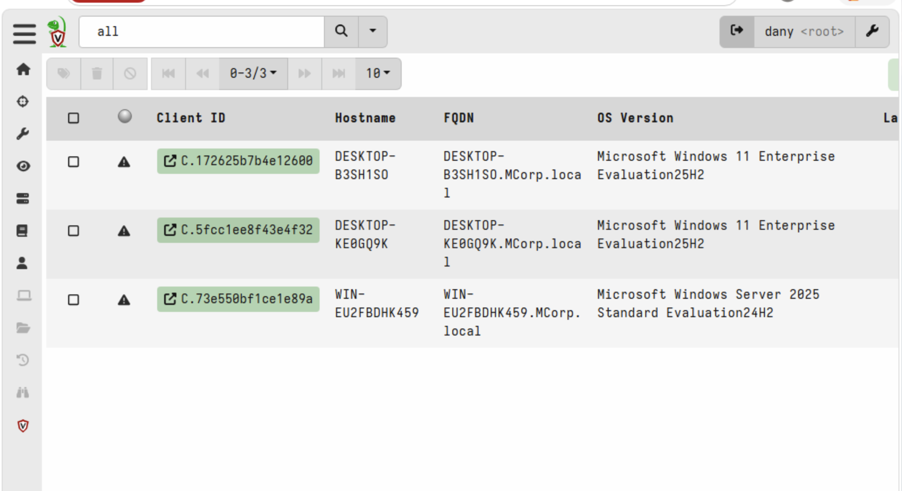

# Velociraptor DFIR and Endpoint Collection

## Purpose

This phase deployed Velociraptor as the lab’s endpoint DFIR and threat-hunting platform.

Velociraptor established centralized endpoint visibility and prepared the Windows systems for future artifact collection, hunts, forensic analysis, and incident-response exercises.

## Scope

This documentation covers the initial Velociraptor deployment and endpoint enrollment process, including:

- Velociraptor deployment on Ubuntu
- Velociraptor web console access
- Windows client installation
- Client enrollment and connectivity
- Enrollment of DC01, Win11-01, and Win11-02
- Validation of connected Windows endpoints
- Preparation for future hunts and artifact collection

## Velociraptor Deployment and Architecture

Velociraptor was deployed on an Ubuntu server within the ALLSAFE security network.

The platform provides centralized DFIR and threat-hunting capabilities for the lab's Windows systems.

The enrolled Windows systems include:

- DC01
- Win11-01
- Win11-02

Velociraptor operates from the defensive security side of the lab and communicates with the enrolled Windows clients for future artifact collection, endpoint investigation, and threat-hunting activities.

This architecture provides a centralized platform for collecting and analyzing endpoint evidence during simulated security investigations.

## Windows Client Enrollment

Velociraptor clients were installed on the Windows systems in the lab and enrolled with the Velociraptor server for centralized endpoint visibility.

The enrolled systems include:

- DC01
- Win11-01
- Win11-02

Client connectivity was verified from the Velociraptor web console to confirm that each Windows system was successfully communicating with the server.

This enrollment establishes the foundation for future DFIR workflows, including endpoint artifact collection, threat hunting, forensic triage, and incident-response investigations.

## Validation

The Velociraptor deployment was validated through the web console by confirming that the enrolled Windows clients were visible and communicating with the server.

Validation included:

- Confirming access to the Velociraptor web console
- Verifying DC01 was enrolled
- Verifying Win11-01 was enrolled
- Verifying Win11-02 was enrolled
- Confirming the Windows clients were visible from the server
- Confirming the environment was ready for future hunts, artifact collection, and forensic analysis

This validation confirmed that Velociraptor connected successfully to the Windows systems and was ready to support future DFIR and threat-hunting workflows.

## Skills Demonstrated

This phase demonstrates foundational DFIR and endpoint investigation skills, including:

- Velociraptor deployment and configuration
- Windows client enrollment
- Endpoint connectivity validation
- Centralized endpoint visibility
- DFIR platform familiarity
- Preparation for artifact collection and forensic triage
- Threat-hunting readiness
- Incident-response workflow preparation

These skills support the broader cybersecurity lab by establishing the endpoint investigation capability needed for future hunts, artifact collection, forensic analysis, and incident-response exercises.

## Evidence

### Velociraptor Web Console

This screenshot shows successful access to the Velociraptor web console hosted on the Ubuntu server within the ALLSAFE network.

### Enrolled Windows Clients

This screenshot shows the Windows clients enrolled with Velociraptor, representing the two Windows 11 endpoints and the Windows Server system used in the lab.

The enrolled clients confirm that Velociraptor can communicate with the Windows environment and provide centralized endpoint visibility for future artifact collection, threat hunting, forensic triage, and incident-response exercises.

---
