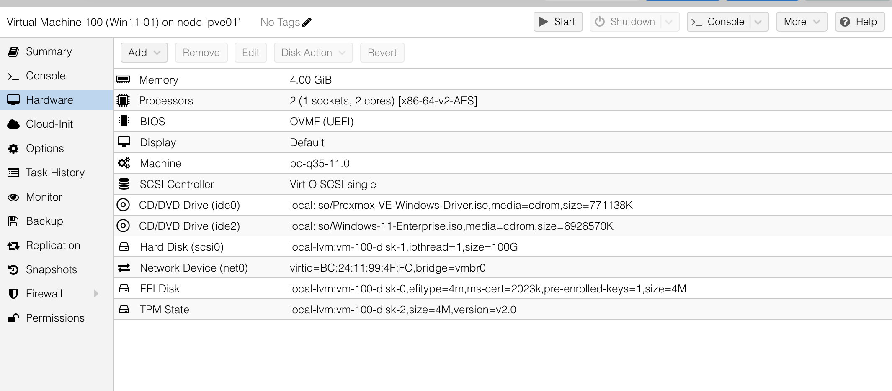
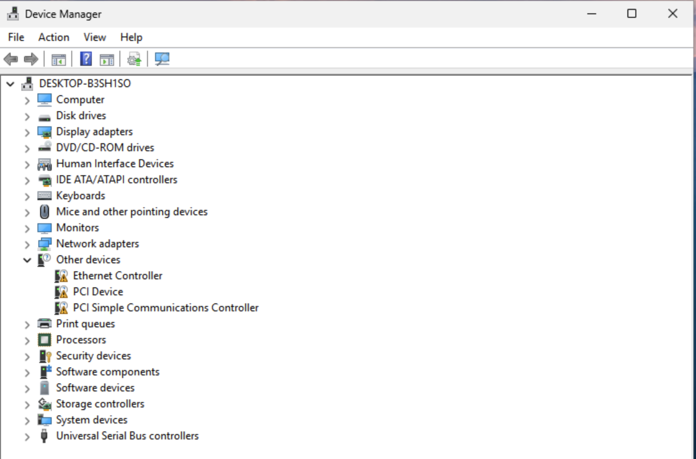
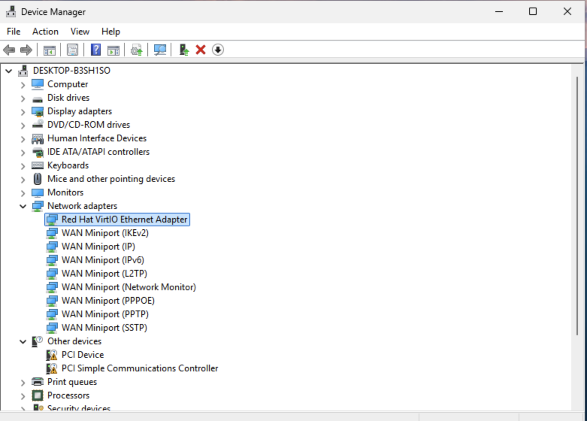
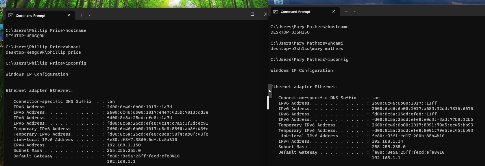

# Windows Endpoint Deployment and Troubleshooting

## Purpose

This phase deployed Windows 11 virtual machines in Proxmox and prepared them for use as enterprise endpoints within the cybersecurity lab.

The Windows endpoints were configured to support domain integration, endpoint telemetry, security monitoring, and future attack simulation and incident-response activities.

## Scope

This documentation covers the Windows endpoint deployment and troubleshooting process, including:

- Windows 11 virtual machine creation
- Virtual hardware configuration
- VirtIO driver installation
- Network adapter troubleshooting
- Endpoint hostname and network validation
- Preparation for Active Directory domain integration
- Preparation for Sysmon, Wazuh, and Velociraptor deployment

## Windows VM Deployment

Two Windows 11 virtual machines were deployed in Proxmox to serve as enterprise endpoints within the lab.

The deployed endpoints are:

- Win11-01
- Win11-02

Each virtual machine was configured with the virtual hardware needed to support Windows installation, networking, domain integration, endpoint telemetry, and security tooling.

VirtIO drivers provided optimized virtualized device support for the Windows systems.

## VirtIO Network Driver Troubleshooting

During deployment of the Windows 11 endpoints, one system initially did not recognize the virtual network adapter.

The issue was traced to missing VirtIO drivers required for the virtualized network device.

Troubleshooting steps included:

- Identifying the missing network adapter in Windows
- Mounting the VirtIO driver ISO
- Installing the appropriate Red Hat VirtIO network driver
- Confirming the virtual Ethernet adapter appeared correctly
- Verifying network connectivity after driver installation

Resolving the driver issue restored network functionality and allowed the endpoint to continue with domain integration and security tooling deployment.

## Endpoint Validation

The Windows endpoints were validated after deployment and troubleshooting to confirm that each system was operating correctly on the lab network.

Validation included:

- Confirming both Windows 11 systems successfully booted
- Verifying hostname and logged-in user information
- Confirming the expected IP configuration
- Verifying network connectivity after VirtIO driver installation
- Confirming the endpoints were ready for Active Directory integration
- Preparing the systems for Sysmon, Wazuh, and Velociraptor deployment

This validation confirmed that the Windows endpoints were stable and ready to support the broader lab environment.

## Skills Demonstrated

This phase demonstrates Windows endpoint deployment and troubleshooting skills, including:

- Windows 11 virtual machine deployment
- Virtual hardware configuration in Proxmox
- VirtIO driver installation
- Network adapter troubleshooting
- Windows endpoint validation
- Hostname, user, and IP configuration verification
- Preparation of endpoints for domain integration
- Preparation for endpoint telemetry and security monitoring

These skills support the broader cybersecurity lab by establishing reliable Windows endpoints for Active Directory, Sysmon, Wazuh, Velociraptor, and future attack simulation and incident-response activities.

## Evidence

### Windows 11 Virtual Machine Hardware

This screenshot shows the virtual hardware configuration for one of the Windows 11 endpoints deployed in Proxmox.

### Missing VirtIO Network Driver

This screenshot shows the Windows endpoint before the required VirtIO network driver was installed, with the virtual network device not yet functioning correctly.

### VirtIO Network Driver Installed

This screenshot shows the endpoint after the VirtIO network driver was installed successfully, restoring the virtual network adapter and network functionality.

### Windows Endpoint Validation

This screenshot shows hostname, logged-in user, and IP configuration validation for the Windows endpoints after deployment and troubleshooting.

---
